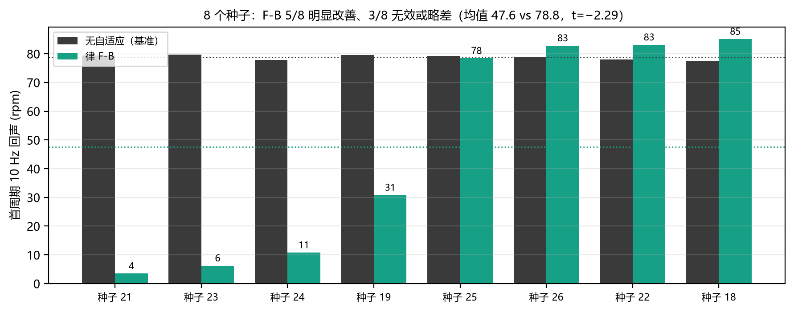

# 回声窗里 F-B 到底有没有效果？（8 个种子实测）

## 直接回答

**有效果，但不稳定**：8 个种子里 **5 个明显改善、3 个无效或略差**。
统计上只是边缘显著（$t=-2.29$，$df=7$，$p\approx0.06$），**不能写成"F-B 能抑制回声"这种无条件结论**。

## 逐种子结果（首周期 10 Hz 回声，rpm）

| 种子 | 无自适应 | 律 F-B | 变化 |
| --- | --- | --- | --- |
| 20261018 | 77.6 | 85.1 | +7.5 ❌ |
| 20261019 | 79.6 | 30.8 | −48.8 ✅ |
| 20261021 | 79.4 | 3.5 | −75.9 ✅ |
| 20261022 | 78.0 | 83.1 | +5.1 ❌ |
| 20261023 | 79.7 | 6.2 | −73.5 ✅ |
| 20261024 | 77.8 | 10.8 | −67.0 ✅ |
| 20261025 | 79.2 | 78.4 | −0.8 ➖ |
| 20261026 | 78.8 | 82.8 | +4.0 ❌ |

| 指标 | 数值 |
| --- | --- |
| 基线 | **78.8 ± 0.8 rpm** |
| F-B | **47.6 ± 38.1 rpm** |
| 配对差 | −31.2 ± 38.5 rpm（中位数 −24.8） |
| 配对 t | −2.29（df=7，p≈0.06） |
| 改善/持平/变差 | 5 / 0 / 3 |

## 为什么是"要么很好、要么没效果"

- 所有 F-B 运行在回声窗内都触发了 **2–3 次**（次数不是变量）；
- 结果呈**双峰**：4 次落在 4–31 rpm，4 次落在 78–85 rpm；
- 与之前 10 rpm / 5 rpm 口径的结论一致：**复位落在 10 Hz 振荡的哪个相位，决定它是抵消还是叠加**。

## 结论与写法

1. 回声窗内 **F-B 确实能起作用**（最好一次把 79 → 3.5 rpm），但**不是每次都能**。
2. 论文若写这一条，必须给 **N≥8 的均值±标准差 + 逐次分布**，并说明复位相位影响；不能只挑一条曲线。
3. 要把"彩票"变"确定收益"，需要**相位对齐复位**（在 10 Hz 过零点触发）或 **$g$ 门控**（避免阶跃误触发），这是下一步要做的改进。
