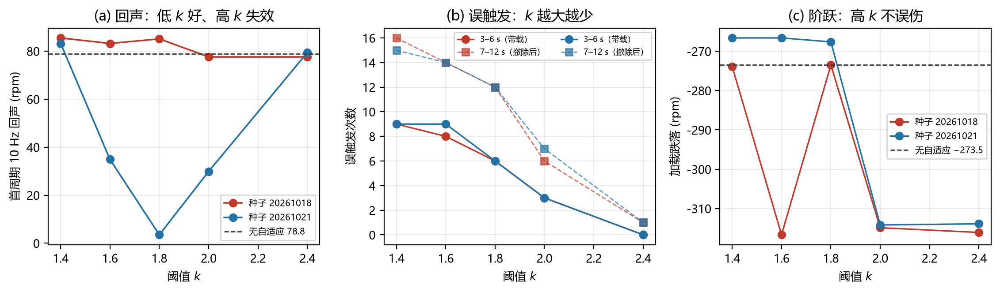

# 调 k 能不能避开"碰线"？

## 结论

**不能。** 调 k 只能调"触发得多少"，调不了"触发在哪一刻"。
k 大到不"碰线"（$k=2.4$）时，回声也一起漏掉（收益归零），而**阶跃仍然触发**（2.001 s）——等于只丢了收益、没躲开伤害。

## 数据（0.2 A / 5 rpm / 负载 2.5%，dq + 三速率）

| k | 种子 | 回声 10 Hz | 加载跌落 | 误触发 3–6 s | 回声窗 6–7 s | 误触发 7–12 s |
| --- | --- | --- | --- | --- | --- | --- |
| 1.4 | 018 | 85.5 | −273.9 | 9 | 3 | 16 |
| 1.6 | 018 | 83.2 | −316.7 | 8 | 2 | 14 |
| **1.8** | 018 | **85.1** | **−273.5** | **6** | **2** | **12** |
| 2.0 | 018 | 77.6 | −314.9 | 3 | 1 | 6 |
| 2.4 | 018 | 77.6 | −316.1 | 0 | 0 | 1 |
| 1.4 | 021 | 83.2 | −266.6 | 9 | 3 | 15 |
| 1.6 | 021 | 34.9 | −266.6 | 9 | 3 | 14 |
| **1.8** | 021 | **3.5** | **−267.6** | **6** | **3** | **12** |
| 2.0 | 021 | 29.9 | −314.2 | 3 | 1 | 7 |
| 2.4 | 021 | 79.4 | −313.9 | 0 | 0 | 1 |

## 三个硬事实

1. **误触发随 k 单调下降**（16 → 1 次/5 s），说明调 k 确实能压"碰线"。
2. **收益随 k 一起消失**：$k=2.4$ 时回声窗 0 次触发，回声回到基线（77.6 / 79.4）。
3. **阶跃的分辨率更高**：$k=2.4$ 时触发时刻是 `[0.001, 0.306, 0.789, **2.001**, 11.715]` s——
   **2.001 s 正是加载阶跃**，而 6 s 的回声一次都没触发。也就是说 $R_{\rm step} > 2.4 > R_{\rm echo}$。

## 为什么单靠 k 分不开

- 阶跃是"幅值大、持续短"，回声是"幅值中、持续长"；两者的 $R$ 峰值只差 0.4 左右。
- 用**单一阈值**去分，必然出现"要么都触发、要么只触发阶跃"的夹缝——这正是技术附注里写的"$k$ 夹缝"。
- 种子的差异（018 从来没好过、021 在 1.6–2.0 有效）说明**相位仍然主导**，k 只是改变了触发时刻的分布。

## 想真正"避开碰线"的三条路

| 方案 | 作用 |
| --- | --- |
| **相位对齐** | 只在 10 Hz 过零点允许复位，把触发时刻钉死 |
| **$g$ 门控** | 用律 D 的非周期能量否决阶跃期触发（阶跃 $g$ 大、回声 $g$ 小） |
| **双阈值/滞回** | 高阈值进入、低阈值保持，避免在阈值附近抖动 |

前两条是结构性的，第三条只是缓解"碰线抖动"，不改变相位问题。
