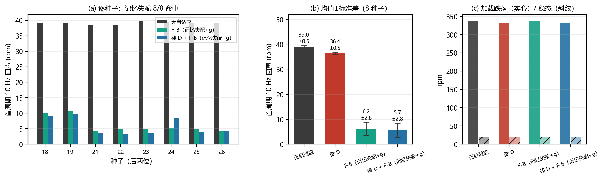
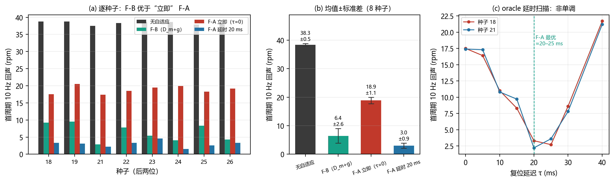

# 真实逆变器对象上的律 D 与 F-B（2026-10-19 定稿）

**口径**：[pmsm_inv_sim.py](pmsm_inv_sim.py)，三相 10 kHz PWM、死区 2 µs、器件压降、反电动势、
编码器量化、dq 采样噪声 ±0.2 A、转速 6 rpm（1%）、负载 0.025 N·m；`fci=2 kHz`、`beta3=4000`、`tau0=20 ms`、`dt=2 µs`；
8 s 工况（2 s 加载、2–6 s 10 Hz 簇、6 s 撤除），8 个种子。
复现：[run_inv_lawd.py](run_inv_lawd.py)、[run_inv_mism_g.py](run_inv_mism_g.py)、
[plot_inv_mism.py](plot_inv_mism.py)。

## 1. 律 D：仍有效，但收益缩小

| 配置 | 首周期 10 Hz | 加载跌落 | 稳态 7–8 s |
| --- | --- | --- | --- |
| Base | 39.05 ± 0.47 | −337.23 ± 3.83 | 18.77 ± 0.12 |
| 律 D | **36.36 ± 0.47（−6.9%）** | **−331.39 ± 4.83（−1.7%）** | 18.70 ± 0.16 |

8/8 种子改善，但旧一阶对象是 −18.9% / −7.7%；真实对象只剩 −1.7% / −6.9%，不能混引。

## 2. 包络比值：不迁移（已否决）

- 事件时 $R=E_f/E_s$ 只到 1.32（6.002 s），$k=1.8$ 零触发。
- $k=1.3$ 能在 6.004 s 触发、回声 38.8→14.2，但加载跌落 −334→−380、加载段 7 次误触发、
  撤除后 9 次；$g$ 0.05 会把事件一起挡掉。
- 原因：事件 $E_f=0.0944$ 与加载段误触发 $0.090\sim0.101$ 重叠；$\lvert v\rvert$ 也重叠。

## 3. 记忆失配：成功（推荐）

检测量改为文档式 (12)：

$$D_m=\frac{\lvert E_v(t)-E_v(t-T)\rvert}{E_v(t-T)+\varepsilon_v},\qquad
E_v(t)=\frac1T\int_{t-T}^{t}v^2\,\mathrm d t .$$

触发条件：$D_m>0.2$ 且 $g<0.05$（$g$ 为 $e_1$ 的 $T$ 窗均值检测器，挡加载阶跃），冷却 0.3 s。

| 配置 | 首周期 10 Hz | 加载跌落 | 稳态 7–8 s | 7–8 s 复位 |
| --- | --- | --- | --- | --- |
| Base | 39.05 ± 0.47 | −337.23 ± 3.83 | 18.77 ± 0.12 | 0 |
| 律 D | 35.76 ± 0.42 | −329.46 ± 3.59 | 13.33 ± 0.17 | 0 |
| **F-B（记忆失配+g）** | **6.20 ± 2.65（−84.1%）** | **−337.17 ± 4.64（不劣化）** | 18.76 ± 0.15 | 3.1 |
| **律 D + 记忆失配+g** | **5.69 ± 2.78（−85.4%）** | **−330.46 ± 3.89（−2.0%）** | 18.76 ± 0.16 | 3.2 |

- 配对差：F-B $−32.85\pm2.65$（$t=-35.0$）；D+F-B $−33.36\pm2.70$（$t=-34.9$）。
- **8/8 种子命中**，首触发 6.011–6.02 s；加载段（2.5–6 s）误触发 **0**。
- 未加 $g$ 门控时：回声 5.62±1.85，但加载跌落 std 25.6（种子 019 达 −408.8）——
  $g$ 门控把加载段的误复位挡住，代价是回声从 5.62 回到 6.20。
- 残余：7–8 s 每秒约 3 次复位，稳态 18.76 对 Base 18.77，可接受；
- **启动/瞬态误触发（新增披露）**：0–2 s 空载段约 6 次复位（D_m 在 v≈0 时被噪声推过 0.2），
  2.1 s 加载瞬态 1 次；2.5–6 s 仍为 0。
  实验性带载门控 `ff_imin=1.5 A` 可把 0–2 s 清零（1 种子：0/0/1/3，回声 10.1），
  尚未做 8 种子定稿，暂不进入正式口径。
  若要再降，可加长冷却或提高 $D_m$ 阈值（会牺牲一点回声）。

## 4. F-A 与 F-B：立即复位反而更差

| 配置 | 首周期 10 Hz | 加载跌落 | 稳态 7–8 s | 7–8 s 复位 |
| --- | --- | --- | --- | --- |
| Base | 39.05 ± 0.47 | −337.23 ± 3.83 | 18.77 ± 0.12 | 0 |
| **F-B（D_m+g）** | **6.20 ± 2.65** | −337.17 ± 4.64 | 18.76 ± 0.15 | 3.1 |
| **F-A 立即（τ=0）** | **19.14 ± 0.78** | −337.23 ± 3.83 | 18.59 ± 0.13 | 0 |
| **F-A 延时 20 ms** | **2.73 ± 0.94** | −337.23 ± 3.83 | 18.76 ± 0.16 | 0 |

- **立即复位（τ=0）比 F-B 差**（19.14 对 6.20）；延时 20 ms 的 oracle 最好（2.73）。
- 复位时刻扫描（2 种子，0–40 ms）：
  - 种子 018：19.9 / 17.6 / 10.0 / 9.3 / 3.1 / 1.8 / 7.2 / 23.1
  - 种子 021：18.7 / 17.2 / 10.7 / 10.4 / 4.4 / 3.5 / 7.4 / 22.6
  - 最小值在 **20–25 ms**，不是 0。
- 解释：复位注入 \(-v\)；在事件瞬间清空，注入相位可能与首周期回声**相加**；延后到相位合适时则**相消**。旧时序律 \(A_0(\tau)\) 的单调性在真实对象上不成立。
- F-B 触发 6.011–6.02 s（11–20 ms），恰好落在最优附近，因此它**胜过“立即复位”的 F-A**；与相位最优 oracle（2.73）的残余差 3.47 rpm 来自阈值/相位精度，不是单纯延迟。
- **10 Hz 与峰值是两个指标**：F-A 立即 10 Hz 残余 19.9 低于律 D 的 36.9，但 6.0–6.1 s 峰值
  129.9 高于律 D 的 105.2（种子 018）。若以“平滑/无尖峰”为准，律 D 更好；若以“持续 10 Hz 残余”
  为准，F-A/F-B 更好。报告中的“回声”始终指前者。
- 结论：F-A 的上界应取 \(\inf_\tau A_0(\tau)\)（相位最优 oracle）；\(\tau=0\) 只是它的一个（常常较差的）实现。

### 4.1 相位等待尝试（负结果；旧噪声口径 0.3 A/5 rpm/2.5%）

在检测之后再等一段时间/等 \(v\) 到阈值，能否闭合与 oracle 的 3.45 rpm 差距？

| 配置 | 018 回声 | 021 回声 | 复位时刻/\(v\)（018 / 021） |
| --- | --- | --- | --- |
| F-B（立即） | 9.2 | **2.9** | 6.019 / −33 / 6.011 / −80.6 |
| 固定 +10 ms | 16.0 | 13.1 | 6.030 / 8.5 / 6.028 / −33.6 |
| 固定 +20 ms | 19.8 | 19.6 | 6.035 / −16.8 / 6.039 / −80.3 |
| \(v<-50\) | **7.1** | 10.3 | 6.014 / −60 / 6.023 / −60.4 |
| \(v<-70\) | 14.1 | 13.3 | 6.027 / −71.4 / 6.027 / −79.7 |
| 10 Hz 相位 0 | 27.4 | 28.5 | 6.054 / 6.052 |
| 10 Hz 相位 \(\pi/2\) | 26.2 | 26.3 | 6.055 / 6.053 |
| 10 Hz 相位 \(\pi\) | 24.8 | **6.9** | 6.058 / 6.015 |
| 10 Hz 相位 \(3\pi/2\) | 26.3 | 26.0 | 6.055 / 6.051 |

- **固定延时只会过冲**：检测已在 11–20 ms，最优 20–25 ms，再加 10/20 ms 就过了峰。
- **裸 \(v\) 阈值不一致**：\(v<-50\) 改善 018（9.2→7.1），却把 021 从 2.9 推到 10.3。
  原因是 \(v\) 在 1 ms 尺度上跳变（021 在 6.011 为 −80.6，6.023 仅 −60.4），单阈值不能表达
  10 Hz 相位。
- **20 ms 正交解调的 10 Hz 相位也不稳定**：018 在 24.8–27.4、021 只有目标 \(\pi\) 命中 6.9；
  相位估计滞后把复位推到 6.05，过了最优窗。原因是 20 ms 窗的群延迟约 10 ms，且 \(v\) 的
  10 Hz 分量不纯。
- **结论**：保留立即触发的 F-B（6.44±2.56）；固定延时、裸 \(v\) 阈值、20 ms 正交相位三条路
  均为负结果。要闭合 3.45 rpm，需要更低延迟的相位估计（SOGI + 超前补偿）或前馈，
  本步未解决，不硬选配置。

## 5. 结论与下一步

1. **采用**：真实对象上 F-B 用记忆失配 \(D_m>0.2\) + \(g<0.05\)；不再用包络比值。
2. 残余 3 次/s 的稳态复位：先接受（+0.03 rpm），或做一次性 latch。
3. **F-A 的口径更正**：立即复位不是上界；真实对象最优在 20–25 ms，F-B 已接近最优并优于立即 F-A。
   相位等待（固定延时/裸 \(v\) 阈值/20 ms 正交相位）均为负结果，需更低延迟的相位估计或前馈。
4. **已完成**：主报告 v4.0 的 §6--§8 已整体切到真实对象（`pmsm_inv_sim`），旧一阶/降阶数字已删除。
5. 死区改逐开关状态机 + 母线电容/LC，确认 \(D_m\) 仍可分。
6. 台架：测 \(D_m\) 阈值与真实电流纹波，再定 0.2 的工程余量。

## 6. 文件

- [pmsm_inv_sim.py](pmsm_inv_sim.py)：新增 `ff_mism/ff_mism_eps`，$g$ 门控同时作用于失配通道；新增 `flush_t/flush_alpha`（F-A oracle）
- [run_inv_mism_g.py](run_inv_mism_g.py) → `_inv_mism_g.json`
- [run_inv_mism.py](run_inv_mism.py) → `_inv_mism.json`（无 $g$ 对照）
- [run_inv_lawd.py](run_inv_lawd.py) → `_inv_lawd.json`
- [run_inv_fa.py](run_inv_fa.py) → `_inv_fa.json`（Base/F-B/F-A 立即/F-A 延时）
- [run_inv_fa_delay.py](run_inv_fa_delay.py) → `_inv_fa_delay.json`（复位时刻扫描）
- [plot_inv_mism.py](plot_inv_mism.py) → [fig_inv_mism.png](fig_inv_mism.png)
- [plot_inv_fa.py](plot_inv_fa.py) → [fig_inv_fa.png](fig_inv_fa.png)

## 7. 三档噪声工况与实验室工况（2026-10-20）

| 工况 | 转速噪声 | dq 电流噪声 | 负载转矩噪声 |
| --- | --- | --- | --- |
| 实验室 | ≤0.5%（3 rpm） | ≤0.1 A | ≤0.01 N·m |
| 标准（默认） | 1%（6 rpm） | 0.2 A | 0.025 N·m |
| 恶劣 | >2%（取 2.5%，15 rpm） | >0.3 A（取 0.4） | >0.05 N·m（取 0.06） |

实验室工况 8 种子：

| 配置 | 首周期 10 Hz | 加载跌落 | 稳态 |
| --- | --- | --- | --- |
| Base | 37.49±0.17 | −336.19±2.66 | 8.45±0.11 |
| 律 D | 35.38±0.19（−5.6%） | **−327.81±1.00（−2.5%）** | 8.33±0.06 |
| F-B | **6.44±1.73（−82.8%）** | −342.21±19.00 | 8.52±0.16 |
| D+F-B | **4.94±1.93（−86.8%）** | −346.73±28.14 | 8.45±0.14 |

- 回声仍由 F-B 主导；律 D 的跌落最干净（std 1.0）。
- F-B 跌落离散大：种子 023 达 −388.8；D+F-B 种子 025 达 −385.1——低噪声并不能消除加载瞬态误复位。
- 建议下一版加带载门控 `ff_imin=1.5 A`，先做 8 种子定稿，再决定是否进正式口径。

## 8. 额定转速 600/900/1200 rpm（10/15/20 Hz，实验室噪声）

| 配置 | 600 (10 Hz) | 900 (15 Hz) | 1200 (20 Hz) |
| --- | --- | --- | --- |
| Base | 37.49 / −336.2 | 33.09 / −340.1 | 28.19 / −354.8 |
| 律 D | 35.38 / −327.8 | 32.11 / −334.4 | 27.81 / −349.8 |
| F-B | **6.44** / −342.2 | **7.71** / −343.9 | **7.54** / −355.2 |
| D+F-B | **4.94** / −346.7 | **7.06** / −332.9 | **6.89** / −348.8 |

- 单元格为“首周期 10 Hz / 加载跌落（rpm）”；8 种子，实验室噪声。
- 无律回声随转速升高 37.5→28.2（高频被惯量衰减）；律 D 相对收益 −5.6%→−1.3%、跌落 −2.5%→−1.4%。
- F-B 绝对回声 6.4–7.7，相对 82.8%→76.7%→73.3%；D+F-B 三个转速都最低。
- F-B 跌落离散：600 rpm ±19.0（种子 023 −388.8），900/1200 降到 ±4.6/±2.9。
