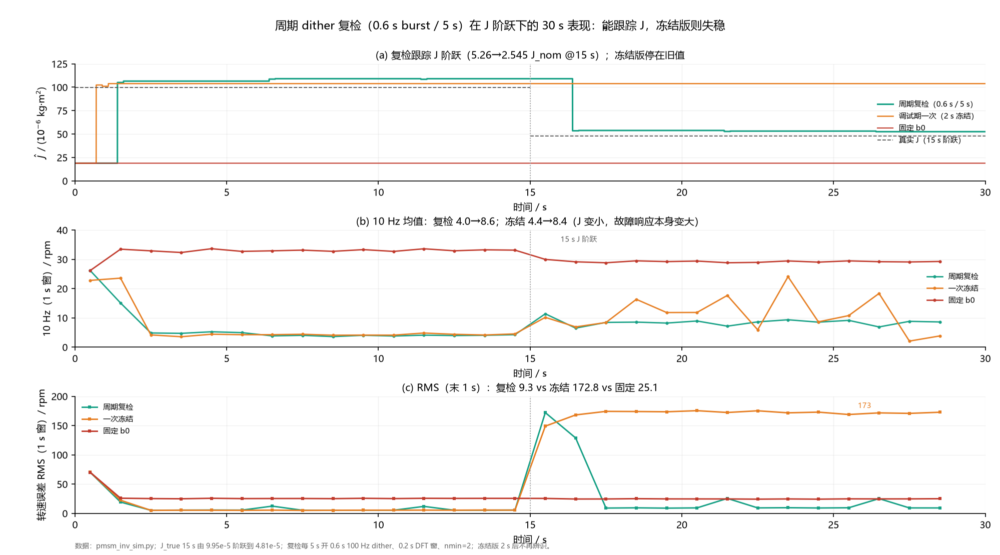

# 律 J 周期 dither 复检：公式、实现与 30 s 阶跃验证

> **方法定位**：不是连续在线辨识，而是“调试期一次辨识 + 运行中周期复检”。复检时开 0.6 s 的 100 Hz dither，用 0.2 s DFT 窗估一次 \(\hat J\)，更新 \(b_0\)，然后关 dither、冻结，直到下一个复检周期。
>
> **口径**：v5.6；600 rpm、\(T_1=0.057\) N·m、10 Hz 故障、实验室噪声、种子 20261018；30 s 阶跃测试中 \(J_{\rm true}\) 在 15 s 由 \(9.95\times10^{-5}\)（5.26\(J_{\rm nom}\)）阶跃到 \(4.81\times10^{-5}\)（2.545\(J_{\rm nom}\)）。
>
> **公式格式**：`mathtype` 代码块为单行 LaTeX，复制到 MathType（开启 TeX 输入）粘贴回车；文末附内联符号的 OMML。

---

## 1. 方法总览与状态机

每个复检周期只做四件事：

1. 开 dither，采 \(T_e\)、\(\omega\)；
2. 用 0.2 s 单频 DFT 算 \(\hat J\)；
3. 更新 \(b_0\)，关 dither；
4. 其余时间冻结，靠 ESO + 状态 4 兜底。

状态机：

| 状态 | 含义 | 进入条件 | 动作 |
|---|---|---|---|
| 0 | 空闲/冻结 | 非 burst 窗 | dither 关，\(b_0\) 保持 |
| 1 | 复检 burst | \(t=t_k\) | 开 dither，累计 DFT |
| 2 | 已应用 | 有效窗 ≥ \(n_{\min}\) | 更新 \(b_0\)，回 0 |
| 3 | 超时/无效 | burst 结束仍无有效窗 | 保持旧 \(b_0\)，回 0 |
| 4 | 校验回退 | 应用后 \(i_q\) AC-RMS 或 10 Hz 恶化 >20% | 回退上一安全 \(b_0\) |
| 5 | 死区 | \(|\rho-1|\le0.20\)，\(\rho=\hat J/J_{\rm nom}\) | 不更新，回 0 |

> 当前试跑实现了 0/1/2/3；状态 4/5 是建议加的每 burst 门控（见 §8）。

## 2. 控制律与 \(b_0\) 回顾

控制律：

```mathtype
u=\frac{1}{b_0}\left[k_p^{\mathrm{eff}}\left(r-z_1\right)-z_2-v\right],\quad k_p^{\mathrm{eff}}=k_p\left(1+k_{p,\mathrm{boost}}g\right)
```

标幺化对象增益：

```mathtype
b=\frac{k_tI_{\mathrm{base}}}{J_{\mathrm{true}}\omega_{\mathrm{ref}}},\quad b_0=1.2\,b\left(J_{\mathrm{nom}}\right)
```

复检要更新的目标：

```mathtype
b_0^{\star}=B_0\frac{J_{\mathrm{nom}}}{\hat J},\quad B_0=1.2\,b\left(J_{\mathrm{nom}}\right)
```

环路增益正比于 \(b k_p/b_0\)；把 \(b_0\) 调到 \(1.2b(J_{\rm true})\) 即恢复设计增益。只改 \(b_0\)，不改 \(k_p\)。

## 3. 复检时序

第一次 burst 从 \(t_0=1.0\) s 开始，之后每 \(T_{\rm rc}=5\) s 一次，每次 \(T_b=0.6\) s：

```mathtype
t_k=t_0+kT_{\mathrm{rc}},\quad k=0,1,2,\dots
```

```mathtype
\mathrm{burst}_k=\left\{t\;\middle|\;t_k\le t<t_k+T_b\right\},\quad T_b=0.6\ \mathrm{s},\ T_{\mathrm{rc}}=5\ \mathrm{s}
```

占空比：

```mathtype
D=\frac{T_b}{T_{\mathrm{rc}}}=\frac{0.6}{5}=12\%
```

burst 外 dither 关、\(b_0\) 冻结；burst 内才允许更新。

## 4. dither 注入

物理转矩 dither：

```mathtype
T_d\left(t\right)=A\sin\left(2\pi f_dt\right),\quad A=0.1\ \mathrm{N\cdot m},\quad f_d=100\ \mathrm{Hz}
```

归一化到电流指令：

```mathtype
u\leftarrow u+a_d\sin\left(\omega_dt\right),\quad a_d=\frac{A}{k_tI_{\mathrm{base}}}=0.157,\quad \omega_d=2\pi f_d
```

100 Hz 与 10 Hz 故障正交；0.2 s 窗恰好是 20 个 100 Hz 周期、2 个 10 Hz 周期。

## 5. 0.2 s 单频 DFT

窗长 \(T_w=0.2\) s，采样 \(T_s=1\) ms，点数 \(N=T_w/T_s=200\)。窗内采样时刻：

```mathtype
t_n=t_k+nT_s,\quad n=0,1,\dots,N-1
```

正交累计：

```mathtype
S_{T,c}=\sum_{n=0}^{N-1}T_e\left(t_n\right)\cos\left(\omega_dt_n\right),\quad
S_{T,s}=\sum_{n=0}^{N-1}T_e\left(t_n\right)\sin\left(\omega_dt_n\right)
```

```mathtype
S_{\omega,c}=\sum_{n=0}^{N-1}\omega\left(t_n\right)\cos\left(\omega_dt_n\right),\quad
S_{\omega,s}=\sum_{n=0}^{N-1}\omega\left(t_n\right)\sin\left(\omega_dt_n\right)
```

幅值：

```mathtype
a_{T}=\frac{2}{N}\sqrt{S_{T,c}^2+S_{T,s}^2},\quad
a_{\omega}=\frac{2}{N}\sqrt{S_{\omega,c}^2+S_{\omega,s}^2}
```

转速幅值换 rpm：

```mathtype
a_{\omega,\mathrm{rpm}}=a_{\omega}\frac{60}{2\pi}
```

## 6. \(\hat J\) 估计与有效窗

单窗估计：

```mathtype
\hat J_i=\frac{a_{T}}{\omega_d\,a_{\omega}},\quad \omega_d=2\pi f_d
```

限幅：

```mathtype
\hat J_i\leftarrow\mathrm{clip}\left(\hat J_i,\ 0.5J_{\mathrm{nom}},\ 50J_{\mathrm{nom}}\right)
```

有效窗判据：

```mathtype
a_{\omega}>0,\quad a_{\omega,\mathrm{rpm}}\ge2\ \mathrm{rpm}
```

每个 burst 至少 \(n_{\min}=2\) 个有效窗；burst 估计取平均：

```mathtype
\hat J_{\mathrm{burst}}=\frac{1}{n}\sum_{i=1}^{n}\hat J_i,\quad n\ge n_{\min}
```

建议再加窗间一致性：

```mathtype
\sqrt{\frac{1}{n}\sum_{i=1}^{n}\left(\hat J_i-\hat J_{\mathrm{burst}}\right)^2}\le0.15\,\hat J_{\mathrm{burst}}
```

不满足则状态 3：保持旧 \(b_0\)，本 burst 作废。

## 7. \(b_0\) 更新与速率限制

目标：

```mathtype
b_0^{\star}=B_0\frac{J_{\mathrm{nom}}}{\hat J_{\mathrm{burst}}}
```

实现里每有效窗更新一次，\(\alpha=0.8\)：

```mathtype
b_0\leftarrow b_0+\alpha\left(b_0^{\star}-b_0\right),\quad \alpha=0.8
```

建议加 burst 级速率限制：

```mathtype
\left|\Delta b_0\right|\le\rho_b\,b_0,\quad \rho_b=0.5\ \mathrm{per\ burst}
```

以及 \(b_0\) 限幅：

```mathtype
b_0\in\left[0.2B_0,\ 5B_0\right]
```

burst 外 \(b_0\) 不更新；下次 burst 从当前值继续。

## 8. 每 burst 的校验/回退与死区

### 8.1 死区

```mathtype
\rho=\frac{\hat J_{\mathrm{burst}}}{J_{\mathrm{nom}}},\quad \left|\rho-1\right|\le0.20
```

满足则状态 5：不更新 \(b_0\)，直接关 dither。

### 8.2 应用后校验

基线窗 \(T_{\rm base}=0.5\) s，后窗 \(T_{\rm post}=0.5\) s；\(i_q\) AC-RMS：

```mathtype
i_{q,\mathrm{AC}}=\sqrt{\frac{1}{N}\sum_{k=1}^{N}i_{q,k}^2-\left(\frac{1}{N}\sum_{k=1}^{N}i_{q,k}\right)^2}
```

10 Hz 幅值：

```mathtype
A_{10}=\frac{2}{N}\left|\sum_{k=1}^{N}e_ke^{-j2\pi10t_k}\right|,\quad e_k=n\left(t_k\right)-n_{\mathrm{ref}}
```

回退判据：

```mathtype
\frac{i_{q,\mathrm{AC}}^{\mathrm{post}}}{i_{q,\mathrm{AC}}^{\mathrm{base}}}>1.20
\quad\mathrm{or}\quad
\left(A_{10}^{\mathrm{base}}\ge2\ \mathrm{rpm}\ \mathrm{and}\ \frac{A_{10}^{\mathrm{post}}}{A_{10}^{\mathrm{base}}}>1.20\right)
```

满足则 \(b_0\leftarrow b_0^{\mathrm{safe}}\)（上一 burst 的安全值），状态 4。

## 9. 30 s J 阶跃结果

设置：15 s 时 \(J_{\rm true}\) 由 \(9.95\times10^{-5}\) 阶跃到 \(4.81\times10^{-5}\)；复检 0.6 s/5 s；对比一次冻结与固定 \(b_0\)。

| 指标 | 周期复检 | 一次冻结 | 固定 \(b_0\) |
|---|---|---|---|
| 15 s 前 10 Hz | **4.0 rpm** | 4.4 rpm | 33 rpm |
| 15 s 后 10 Hz 均值 | 8.6 rpm | 8.4 rpm | 29 rpm |
| 15 s 后 RMS（末 1 s） | **9.3 rpm** | **172.8 rpm** | 25.1 rpm |
| \(\hat J\) 终值 | \(5.26\times10^{-5}\)（+9.3%） | \(1.04\times10^{-4}\)（停在旧值） | — |

判读：

- 复检在 16 s 的 burst 后把 \(\hat J\) 从 \(1.04\times10^{-4}\) 拉到 \(5.26\times10^{-5}\)，误差 +9.3%，落在 ±10% 内；
- 15 s 后 10 Hz 的 8.6 rpm 是 **J 变小后的物理故障响应**，不是失稳；真正区分稳定性的指标是 RMS：复检 9.3 vs 冻结 172.8；
- 代价：dither 占空比 12%；J 阶跃瞬间 \(i_q\) 原始峰值 22.6 A（冻结 20.7 A），需速率限制/状态 4 门控。



## 10. 参数表

| 参数 | 取值 | 说明 |
|---|---|---|
| \(f_d\) / \(A\) | 100 Hz / 0.1 N·m | dither |
| \(a_d\) | 0.157 | 归一化电流幅值 |
| \(T_w\) / \(N\) | 0.2 s / 200 | DFT 窗 |
| \(T_b\) / \(T_{\rm rc}\) | 0.6 s / 5 s | burst / 周期 |
| \(D\) | 12% | 占空比 |
| \(t_0\) | 1.0 s | 首次 burst |
| \(n_{\min}\) | 2 | 每 burst 有效窗 |
| SNR 门限 | 2 rpm | \(a_{\omega,\rm rpm}\) |
| \(\hat J\) 限幅 | [0.5, 50] \(J_{\rm nom}\) | |
| \(\alpha\) | 0.8 | 每窗 \(b_0\) 更新 |
| \(\rho_b\) | 0.5/burst | 建议速率限制 |
| \(J_{\rm nom}\) | \(1.89\times10^{-5}\) | |
| \(B_0\) | 643.7 s⁻¹ | 600 rpm、\(J_{\rm nom}\) |
| 额定电流 | 6.31 A（1 ms 包络） | 10 µs 原始峰值含 PWM 纹波 |

## 11. 伪代码

```text
每 1 ms 控制拍：
  if not active and t >= t_next:
      active = True; t_end = t + 0.6; t_next = t + 5.0
      clear windows, accumulators
  if active and t < t_end:
      u += 0.157 * sin(2*pi*100*t)
      accumulate Te*cos, Te*sin, w*cos, w*sin
      if n == 200:
          aT = 2/N*hypot(STc,STs); aw = 2/N*hypot(Swc,Sws)
          if aw > 0 and aw*60/(2*pi) >= 2:
              J = clip(aT/(2*pi*100*aw), 0.5*JM, 50*JM)
              windows.append(J)
              if len(windows) >= 2:
                  Jb = mean(windows)
                  b0 += 0.8*(B0*JM/Jb - b0)   # 建议再加速率限制/状态4
          reset accumulators
  elif active and t >= t_end:
      active = False
```

## 12. 与其他方法对比

| 方法 | 30 s 结果 | 结论 |
|---|---|---|
| 固定 \(b_0\) | 10 Hz 33→29，RMS 25 | 基准 |
| 一次冻结 DFT | 阶跃后 RMS 172.8 | 不适应 J 变化 |
| 简化 DO | 10 Hz 35.2，\(\hat J\) −61% | 不收敛 |
| AKO+RLS | 10 Hz 50.9，\(\hat J\) −84% | 不收敛/非极限环 |
| **周期复检** | **RMS 9.3，\(\hat J\) +9.3%** | **可用（准实时）** |

## 13. 边界与下一步

1. **5 s 周期偏长**：J 阶跃后到 16 s 才复检，1.4 s 失配造成 RMS 尖峰；可改 2 s 周期（占空比 30%）或事件触发。
2. **\(i_q\) 尖峰**：22.6 A 是阶跃瞬态；加 \(b_0\) 速率限制（\(\rho_b=0.5\)/burst）或状态 4 门控可压。
3. **J 阶跃是人为测试**：真实台架 J 不会突跳；复检的价值在于换圆盘/换负载后的再整定，以及慢漂移。
4. **编码器 6 rpm**：SNR 门限 2 rpm 已接近量化极限；再低不可靠。
5. **下一步**：2 s/5 s/10 s 三档周期对比；每 burst 状态 4 校验；台架实测。

---

## 附：内联符号的 OMML

> 每个注释行下一行是 m:oMath 元素；复制到 PPT/Word 按你的 OMML 流程转公式。单行字母与短式在这里，长公式用上面的 MathType 块。逐符号 OMML 清单可按需另出。

```xml
<!-- J_nom -->
<m:oMath xmlns:m="http://schemas.openxmlformats.org/officeDocument/2006/math"><m:sSub><m:e><m:r><m:t>𝐽</m:t></m:r></m:e><m:sub><m:r><m:t>𝑛𝑜𝑚</m:t></m:r></m:sub></m:sSub></m:oMath>
<!-- J_true -->
<m:oMath xmlns:m="http://schemas.openxmlformats.org/officeDocument/2006/math"><m:sSub><m:e><m:r><m:t>𝐽</m:t></m:r></m:e><m:sub><m:r><m:t>𝑡𝑟𝑢𝑒</m:t></m:r></m:sub></m:sSub></m:oMath>
<!-- Jhat -->
<m:oMath xmlns:m="http://schemas.openxmlformats.org/officeDocument/2006/math"><m:acc><m:accPr><m:chr m:val="̂"/></m:accPr><m:e><m:r><m:t>𝐽</m:t></m:r></m:e></m:acc></m:oMath>
<!-- b0 -->
<m:oMath xmlns:m="http://schemas.openxmlformats.org/officeDocument/2006/math"><m:sSub><m:e><m:r><m:t>𝑏</m:t></m:r></m:e><m:sub><m:r><m:t>0</m:t></m:r></m:sub></m:sSub></m:oMath>
<!-- b -->
<m:oMath xmlns:m="http://schemas.openxmlformats.org/officeDocument/2006/math"><m:r><m:t>𝑏</m:t></m:r></m:oMath>
<!-- omega_d -->
<m:oMath xmlns:m="http://schemas.openxmlformats.org/officeDocument/2006/math"><m:sSub><m:e><m:r><m:t>𝜔</m:t></m:r></m:e><m:sub><m:r><m:t>𝑑</m:t></m:r></m:sub></m:sSub></m:oMath>
<!-- f_d -->
<m:oMath xmlns:m="http://schemas.openxmlformats.org/officeDocument/2006/math"><m:sSub><m:e><m:r><m:t>𝑓</m:t></m:r></m:e><m:sub><m:r><m:t>𝑑</m:t></m:r></m:sub></m:sSub></m:oMath>
<!-- T_b -->
<m:oMath xmlns:m="http://schemas.openxmlformats.org/officeDocument/2006/math"><m:sSub><m:e><m:r><m:t>𝑇</m:t></m:r></m:e><m:sub><m:r><m:t>𝑏</m:t></m:r></m:sub></m:sSub></m:oMath>
<!-- T_rc -->
<m:oMath xmlns:m="http://schemas.openxmlformats.org/officeDocument/2006/math"><m:sSub><m:e><m:r><m:t>𝑇</m:t></m:r></m:e><m:sub><m:r><m:t>𝑟𝑐</m:t></m:r></m:sub></m:sSub></m:oMath>
<!-- D -->
<m:oMath xmlns:m="http://schemas.openxmlformats.org/officeDocument/2006/math"><m:r><m:t>𝐷</m:t></m:r></m:oMath>
<!-- a_d -->
<m:oMath xmlns:m="http://schemas.openxmlformats.org/officeDocument/2006/math"><m:sSub><m:e><m:r><m:t>𝑎</m:t></m:r></m:e><m:sub><m:r><m:t>𝑑</m:t></m:r></m:sub></m:sSub></m:oMath>
<!-- A -->
<m:oMath xmlns:m="http://schemas.openxmlformats.org/officeDocument/2006/math"><m:r><m:t>𝐴</m:t></m:r></m:oMath>
<!-- N -->
<m:oMath xmlns:m="http://schemas.openxmlformats.org/officeDocument/2006/math"><m:r><m:t>𝑁</m:t></m:r></m:oMath>
<!-- T_e -->
<m:oMath xmlns:m="http://schemas.openxmlformats.org/officeDocument/2006/math"><m:sSub><m:e><m:r><m:t>𝑇</m:t></m:r></m:e><m:sub><m:r><m:t>𝑒</m:t></m:r></m:sub></m:sSub></m:oMath>
<!-- omega -->
<m:oMath xmlns:m="http://schemas.openxmlformats.org/officeDocument/2006/math"><m:r><m:t>𝜔</m:t></m:r></m:oMath>
<!-- a_T -->
<m:oMath xmlns:m="http://schemas.openxmlformats.org/officeDocument/2006/math"><m:sSub><m:e><m:r><m:t>𝑎</m:t></m:r></m:e><m:sub><m:r><m:t>𝑇</m:t></m:r></m:sub></m:sSub></m:oMath>
<!-- a_omega -->
<m:oMath xmlns:m="http://schemas.openxmlformats.org/officeDocument/2006/math"><m:sSub><m:e><m:r><m:t>𝑎</m:t></m:r></m:e><m:sub><m:r><m:t>𝜔</m:t></m:r></m:sub></m:sSub></m:oMath>
<!-- alpha -->
<m:oMath xmlns:m="http://schemas.openxmlformats.org/officeDocument/2006/math"><m:r><m:t>𝛼</m:t></m:r></m:oMath>
<!-- rho_b -->
<m:oMath xmlns:m="http://schemas.openxmlformats.org/officeDocument/2006/math"><m:sSub><m:e><m:r><m:t>𝜌</m:t></m:r></m:e><m:sub><m:r><m:t>𝑏</m:t></m:r></m:sub></m:sSub></m:oMath>
<!-- Jhat_i -->
<m:oMath xmlns:m="http://schemas.openxmlformats.org/officeDocument/2006/math"><m:sSub><m:e><m:acc><m:accPr><m:chr m:val="̂"/></m:accPr><m:e><m:r><m:t>𝐽</m:t></m:r></m:e></m:acc></m:e><m:sub><m:r><m:t>𝑖</m:t></m:r></m:sub></m:sSub><m:r><m:t>=</m:t></m:r><m:f><m:num><m:sSub><m:e><m:r><m:t>𝑎</m:t></m:r></m:e><m:sub><m:r><m:t>𝑇</m:t></m:r></m:sub></m:sSub></m:num><m:den><m:sSub><m:e><m:r><m:t>𝜔</m:t></m:r></m:e><m:sub><m:r><m:t>𝑑</m:t></m:r></m:sub></m:sSub><m:sSub><m:e><m:r><m:t>𝑎</m:t></m:r></m:e><m:sub><m:r><m:t>𝜔</m:t></m:r></m:sub></m:sSub></m:den></m:f></m:oMath>
<!-- b0_update -->
<m:oMath xmlns:m="http://schemas.openxmlformats.org/officeDocument/2006/math"><m:sSub><m:e><m:r><m:t>𝑏</m:t></m:r></m:e><m:sub><m:r><m:t>0</m:t></m:r></m:sub></m:sSub><m:r><m:t>←</m:t></m:r><m:sSub><m:e><m:r><m:t>𝑏</m:t></m:r></m:e><m:sub><m:r><m:t>0</m:t></m:r></m:sub></m:sSub><m:r><m:t>+</m:t></m:r><m:r><m:t>𝛼</m:t></m:r><m:d><m:dPr><m:begChr m:val="("/><m:endChr m:val=")"/></m:dPr><m:e><m:sSup><m:e><m:sSub><m:e><m:r><m:t>𝑏</m:t></m:r></m:e><m:sub><m:r><m:t>0</m:t></m:r></m:sub></m:sSub></m:e><m:sup><m:r><m:t>★</m:t></m:r></m:sup></m:sSup><m:r><m:t>−</m:t></m:r><m:sSub><m:e><m:r><m:t>𝑏</m:t></m:r></m:e><m:sub><m:r><m:t>0</m:t></m:r></m:sub></m:sSub></m:e></m:d></m:oMath>
<!-- schedule -->
<m:oMath xmlns:m="http://schemas.openxmlformats.org/officeDocument/2006/math"><m:sSub><m:e><m:r><m:t>𝑡</m:t></m:r></m:e><m:sub><m:r><m:t>𝑘</m:t></m:r></m:sub></m:sSub><m:r><m:t>=</m:t></m:r><m:sSub><m:e><m:r><m:t>𝑡</m:t></m:r></m:e><m:sub><m:r><m:t>0</m:t></m:r></m:sub></m:sSub><m:r><m:t>+</m:t></m:r><m:r><m:t>𝑘</m:t></m:r><m:sSub><m:e><m:r><m:t>𝑇</m:t></m:r></m:e><m:sub><m:r><m:t>𝑟𝑐</m:t></m:r></m:sub></m:sSub></m:oMath>
<!-- duty -->
<m:oMath xmlns:m="http://schemas.openxmlformats.org/officeDocument/2006/math"><m:r><m:t>𝐷</m:t></m:r><m:r><m:t>=</m:t></m:r><m:f><m:num><m:sSub><m:e><m:r><m:t>𝑇</m:t></m:r></m:e><m:sub><m:r><m:t>𝑏</m:t></m:r></m:sub></m:sSub></m:num><m:den><m:sSub><m:e><m:r><m:t>𝑇</m:t></m:r></m:e><m:sub><m:r><m:t>𝑟𝑐</m:t></m:r></m:sub></m:sSub></m:den></m:f></m:oMath>
<!-- aw_rpm -->
<m:oMath xmlns:m="http://schemas.openxmlformats.org/officeDocument/2006/math"><m:sSub><m:e><m:r><m:t>𝑎</m:t></m:r></m:e><m:sub><m:r><m:t>𝜔</m:t></m:r></m:sub></m:sSub><m:r><m:t>,𝑟𝑝𝑚</m:t></m:r><m:r><m:t>=</m:t></m:r><m:sSub><m:e><m:r><m:t>𝑎</m:t></m:r></m:e><m:sub><m:r><m:t>𝜔</m:t></m:r></m:sub></m:sSub><m:f><m:num><m:r><m:t>60</m:t></m:r></m:num><m:den><m:r><m:t>2</m:t></m:r><m:r><m:t>𝜋</m:t></m:r></m:den></m:f></m:oMath>
```
